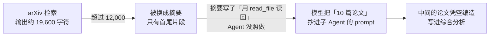
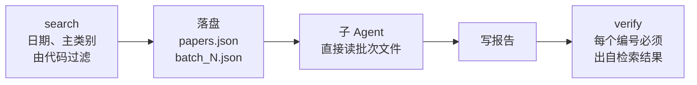
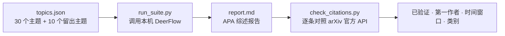

# deerflow-citeguard

[](https://github.com/unumbrela/deerflow-citeguard/actions/workflows/test.yml)

让「文献综述 Agent」不再编造论文。

在字节开源的多 Agent 框架 [DeerFlow](https://github.com/bytedance/deer-flow) 上,我量化了它的文献综述 skill 会不会编造引用,查清了原因,并用确定性的代码把这条失败路径堵死。**不改 DeerFlow 核心**,以 custom skill 的方式覆盖上游同名 skill。

- **问题**:30 个主题里,4/29 份报告有一半以上引用是虚构的(编号、标题、作者全是编的);时间窗口、类别约束也只满足约 70%。
- **根因**:检索输出过长被 DeerFlow 换成"摘要",Agent 没把原文读回来,就把凭空补全的"论文"抄给子 Agent。
- **做法**:论文数据由脚本落盘、分批,子 Agent 直接读文件,模型不再转述;报告写完由脚本核对每个 arXiv 编号是否出自检索结果。
- **结果**(10 个未见过的主题):三项约束全满足的运行 **1/10 → 10/10**。代价:token +21%。

> 完整过程、每次实验的原始记录和走过的弯路:[BASELINE.md](BASELINE.md) · 项目日志:[PLAN.md](PLAN.md) · 面试讲解稿:[docs/INTERVIEW.md](docs/INTERVIEW.md)

## 问题是怎么发生的,又是怎么修的

**上游 skill:模型转述论文数据**



**v2.1:代码搬运,模型不转述**



证据(基线 29 个运行,逐个追踪调用链):检索输出被外置后,**Agent 读回原文的 18 个运行 0 个编造;没读回的 4 个运行 4 个全部编造**(Fisher p = 0.00014)。这是观察性分组,不是对照实验。

## 结果


| 留出评测(10 个未见主题 × 1 次) | 上游 skill | v2.1 |
|---|---|---|
| 三项约束每条引用都满足的运行 | 1 / 10 | **10 / 10**(p = 0.0001) |
| 凑够 10 篇的运行 | 8 / 10 | 10 / 10 |
| 一半以上编造的运行 | 2 / 9 | 0 / 10(不显著) |
| 平均耗时 | 291 秒 | 190 秒 |
| 平均 token | 209,938 | **253,674(+21%)** |

**要如实说的**:样本只有 10 个主题 × 1 次,无置信区间;编造次数的差异在这个样本量下**不显著**,可信度主要来自上面追踪到的机制;**成本没有改善**;评测只核对引用能否对上 arXiv,不评价综述内容本身的质量。基线臂有 1 个运行原因不明地中断,按预先写定的规则计为未交付(排除它结论不变)。

改进过程中还有一个教训:v2.0 消除了编造,却让 7/30 的报告凑不够 10 篇(精确短语匹配太窄,Agent 凑不够时还自己去掉了类别过滤)。v2.1 改为由代码放宽查询、保持用户约束不动。**这个修复是看过失败后写的,所以 30 主题上的成绩是样本内的;可信的是上表的留出结果**,其方案在运行前就已提交([eval/HOLDOUT.md](eval/HOLDOUT.md))。

## 评测怎么做



主指标是 **已验证**(arXiv 编号存在**且标题对得上**)。早期用过"编号存在",结果被虚构编号蒙混过关(假通过 10/10,实为 1/10),所以改了。

## 仓库结构

```
eval/      评测框架:主题集、运行器、arXiv 引用核查、汇总;HOLDOUT.md 是留出评测方案
skills/    改进版 systematic-literature-review(源码)+ 19 个离线单元测试
scripts/   install_skill.sh:把 skills/ 部署为 DeerFlow 的 custom skill
runs/      各次实验的报告、引用核查和元数据(原始 trace 因体积未入库)
docs/      面试讲解稿、结果图(make_chart.py 从 summary.json 生成)
```

`deer-flow/`(上游代码)不在本仓库内,基线固定在上游 commit `3fdd9bd`。

## 复现

前置:本机 Docker 里跑着 DeerFlow(`make docker-start`),`config.yaml` 配好模型。评测用的设置:`qwen3.5-plus`(阿里云百炼)、`memory.enabled: false`、`allow_host_bash: true`、递归上限 1000。

```bash
git clone https://github.com/bytedance/deer-flow deer-flow && git -C deer-flow checkout 3fdd9bd
scripts/install_skill.sh && docker restart deer-flow-gateway     # 部署 v2.1(网关会缓存技能列表,必须重启)

cd eval
python3 -I run_suite.py --name my-run --reps 1 --workers 2       # 跑 30 个主题;留出集加 --topics holdout_topics.json
python3 -I aggregate.py --name my-run                            # 逐条核对 arXiv 并汇总
python3 -m unittest discover -s ../skills/systematic-literature-review/tests
```

`run_task.py` 需要本地 DeerFlow 账号的 cookie,放在被忽略的 `.local/cookies.txt`。

## 联调中发现的三个环境事实

1. 网关按配置缓存技能列表,新增 skill 后必须重启。
2. custom skill 在沙箱里的路径是 `/mnt/skills/legacy/<name>/`,不是 `custom`。
3. LocalSandbox 只翻译**命令行里出现的** `/mnt/user-data/...`;脚本内部默认的路径落在容器字面路径上,文件工具和子 Agent 都看不到。所以 `--out-dir` 必须由调用方显式传入。

## 安全提示

评测期间为让 skill 脚本能跑,打开了 `allow_host_bash: true`:模型可以在网关容器内执行任意 shell,而容器环境变量里有模型 API key,存在提示注入外泄的风险。只适合本机单用户场景,不要在多用户或暴露公网的部署里开启。

## 许可

基于 [DeerFlow](https://github.com/bytedance/deer-flow)(MIT)。`arxiv_search.py` 与引用模板来自上游 skill,本仓库在其基础上修改。许可证见 [LICENSE](LICENSE)(MIT,保留上游版权声明)。
