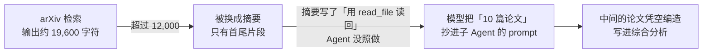
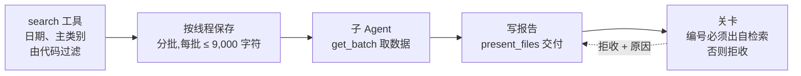
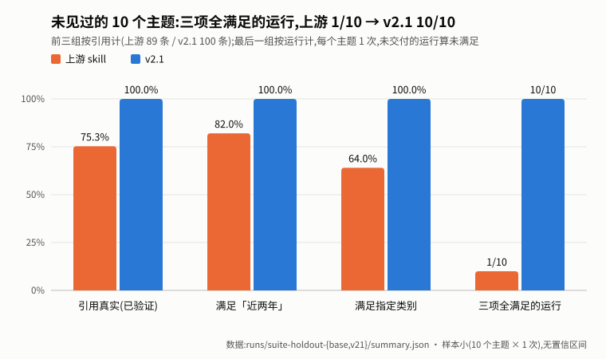
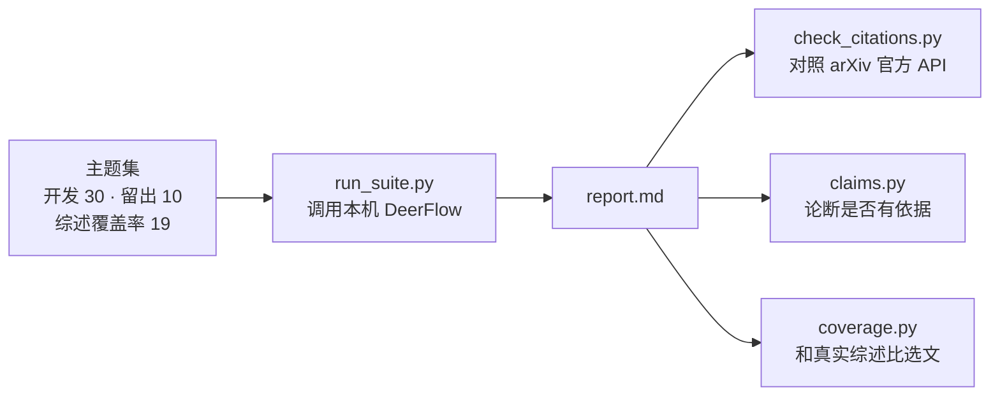

# deerflow-citeguard

[](https://github.com/unumbrela/deerflow-citeguard/actions/workflows/test.yml)

让「文献综述 Agent」不再编造论文。

在字节开源的多 Agent 框架 [DeerFlow](https://github.com/bytedance/deer-flow) 上,我先量化了它的文献综述 skill 编造引用的频率,再查清原因,最后用代码把这条失败路径堵住。全部改动做成 **插件 + custom skill**,不改 DeerFlow 核心。

- **问题**:上游 skill 在 10 个未见主题 × 3 次里,三分之一的报告有一半以上引用是编的(编号、标题、作者都是假的);时间窗口、类别约束也常不满足。
- **根因**:检索输出太长,被 DeerFlow 换成摘要。Agent 没把原文读回来,就把凭空补全的"论文"抄给了子 Agent。
- **做法**:检索、过滤、分批都由插件代码完成,子 Agent 按批次号直接取论文数据,模型不再转述;报告交付时由关卡核对每个 arXiv 编号是否出自本次检索,不通过就拒收。
- **结果**:三项约束全满足的运行 **1/30 → 29/30**,耗时 −38%,token −16%;不再需要 `allow_host_bash`。

> 完整过程和每次实验的原始记录:[BASELINE.md](BASELINE.md) · 升级与执行计划:[ROADMAP.md](ROADMAP.md) · 面试讲解稿:[docs/INTERVIEW.md](docs/INTERVIEW.md) · 上游 issue:[bytedance/deer-flow#7601](https://github.com/bytedance/deer-flow/issues/7601)

> **版本说明**：下方主结果来自历史 v3 实验；当前全文证据能力仍在开发，不能直接套用这些成绩。当前状态、实施顺序与验收标准统一维护在 [ROADMAP.md](ROADMAP.md)。

## 问题是怎么发生的,又是怎么修的

**上游 skill:模型转述论文数据**



**v3:代码搬运,模型不转述**



证据:上游 skill 的检索输出被外置后,**读回原文的运行几乎不编造,没读回的几乎都编造**(30 主题基线 0/18 对 4/4,第二轮留出 0/18 对 9/10)。这是观察性分组,不是对照实验。

## 结果



10 个没调过参的主题,每臂每题跑 3 次,方案运行前已提交([eval/HOLDOUT.md](eval/HOLDOUT.md))。

| | 上游 skill | v3 |
|---|---|---|
| **三项约束全满足且交付 10 篇的运行** | 1 / 30(95% CI 0.6%–16.7%) | **29 / 30**(83.3%–99.4%) |
| 一半以上引用编造的运行 | 9 / 28 | **0 / 30**(p = 0.0006) |
| 交付报告 | 28 / 30 | 30 / 30 |
| 平均耗时 | 310 秒 | 191 秒 |
| 平均 token | 264,709 | 222,812 |

**要如实说的**:
- 同一主题的 3 次不独立;按主题算,3 次都达标的主题是 0/10 对 9/10。
- 编造率是次要指标,预先指定的主指标是第一行。
- token 取 DeerFlow 运行记录(每次模型调用的回调统计,含子 Agent、摘要器与筛选模型;逐运行数字见 `runs/token-run-record-20261027.json`)。旧口径只算最终状态里的消息,上下文被摘要后会漏计,且对上游臂漏计更多,所以旧数字显示两臂持平(208,090 对 207,323)。−16% 是均值之比,未做检验。
- v3 唯一不达标的运行检索到 10 篇、只引了 9 篇。v3.1 已在关卡里加了篇数检查,还没做正式评测。

## 评测怎么做



| 指标 | 含义 | 状态 |
|---|---|---|
| 引用已验证 | arXiv 编号存在**且标题对得上**(只查编号会被虚构编号蒙混过关) | 主指标 |
| 时间窗口 / 类别 | 每条引用是否满足用户的约束 | 主指标 |
| 论断支持率 | 报告里每句话引用的论文,摘要是否支持它(LLM 评判) | v3 92.6%,上游 60.6%;只算真实引用仍高 11.7 个百分点(95% CI 7.4–16.3)。评判器与参考标签 κ = 0.74(留出) |
| 覆盖率 | 选的论文里,同主题真实综述也引用了的比例 | 开发集起点 12.5%(v3.1);主要受检索限制,是下一阶段要提升的指标 |

## 仓库结构

```
extensions/scholar/  DeerFlow 插件:search、get_batch 工具 + 引用关卡(离线单测)
skills/              改进版 systematic-literature-review,以 custom skill 覆盖上游同名 skill
eval/                主题集、运行器、引用核查、论断支持率、覆盖率基准(离线单测)
scripts/             install_skill.sh 部署 skill;switch_arm.sh 在两个评测配置间切换
runs/                每次实验的报告、核查结果和元数据(原始 trace 因体积未入库)
docs/                面试讲解稿、结果图(make_chart.py 从 summary.json 生成)
```

`deer-flow/`(上游代码)不在本仓库内,基线固定在上游 commit `3fdd9bd`。

## 复现

离线检查与源码快照见 [docs/REPRODUCE.md](docs/REPRODUCE.md)。以下是在线评测入口，历史结果必须配套当时的源码与配置；`switch_arm.sh v3` 只切换当前配置，不会自动恢复历史 v3 版本。

前置:本机 Docker 里跑着 DeerFlow(`make docker-start`),`config.yaml` 配好模型(评测用 `qwen3.5-plus`、`memory.enabled: false`)。

```bash
git clone https://github.com/bytedance/deer-flow deer-flow && git -C deer-flow checkout 3fdd9bd
# 安装插件:见 extensions/scholar/README.md
scripts/switch_arm.sh v3            # 或 baseline;会改 config.yaml 并重启网关

cd eval
python3 -I run_suite.py --name my-run --topics holdout_topics.json --reps 3
python3 -I aggregate.py --name my-run          # 逐条核对 arXiv 并汇总
python3 -I holdout_report.py my-run            # 主指标与置信区间
```

`run_task.py` 需要本地 DeerFlow 账号的 cookie,放在被忽略的 `.local/cookies.txt`。

## 踩过的坑

1. 网关会缓存技能列表,改了 skill 必须重启。
2. 插件以快照方式安装,改代码后要 `deerflow extensions upgrade`。
3. 插件的 `wrap_tool_call` 只能观察、不能否决,所以关卡放在 `before_model`,按消息 ID 改写 `present_files` 的结果。代价是被拒的文件用户仍看得到,提示语会如实说明。

## 安全

v3 关闭了 `allow_host_bash`。只有评测里的上游 skill 一臂需要打开它,因为上游 skill 要靠 bash 跑检索脚本。打开时,模型可以在装着 API key 的容器里执行任意命令,所以只适合本机单用户。

## 许可

基于 [DeerFlow](https://github.com/bytedance/deer-flow)(MIT)。arXiv 检索逻辑与引用模板来自上游 skill,本仓库在其基础上修改。许可证见 [LICENSE](LICENSE)(MIT,保留上游版权声明)。
